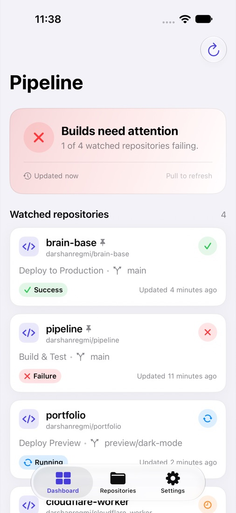
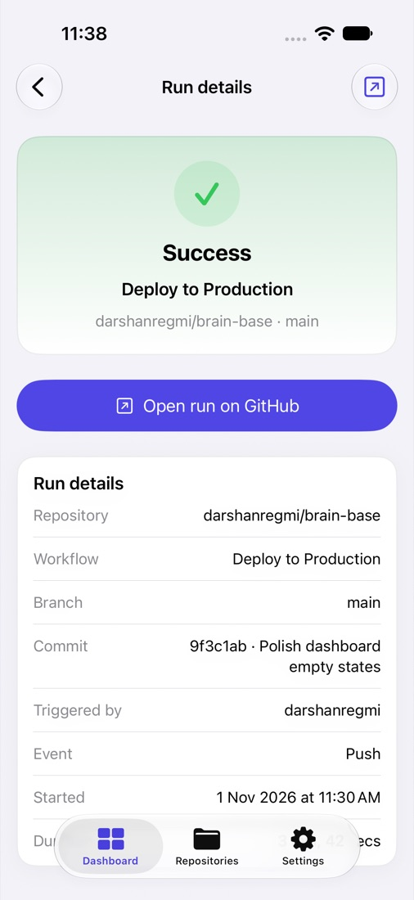

# Pipeline

**CI/CD status at a glance.**

Pipeline is an iPhone-first app that answers one question before you open your
laptop: _are my builds green?_ It shows the latest GitHub Actions result for the
repositories you care about, with a dashboard, repository picker, run details,
and settings.

> **Project status: Week 1 UI prototype.** The interface is complete and runs
> on realistic sample data. GitHub networking, local caching, and the widget are
> planned next. See [docs/ROADMAP.md](docs/ROADMAP.md).

<p align="center">
  
  &nbsp;&nbsp;
  
</p>

## What's included

- **Connect flow** — paste a fine-grained personal access token, show or hide it,
  validate its format locally, and store it in the iOS Keychain. A demo mode
  opens the full interface without a token.
- **Dashboard** — overall health summary, watched repositories, pull-to-refresh,
  loading and error states.
- **Repositories** — searchable repository list with watch toggles and a
  pinned-to-widget indicator.
- **Repository detail** — latest status, recent runs, and watch, pin, or
  open-on-GitHub actions.
- **Run detail** — status hero, run metadata, and a link to GitHub.
- **Settings** — connection status, disconnect, delete all local data, and an
  About screen.
- **Accessibility** — status is never conveyed by color alone; VoiceOver labels,
  Dynamic Type, and Reduce Motion are supported throughout.

## Requirements

- Xcode 27.2 or newer
- iOS 27.2 simulator or device
- Swift 6.4.2 toolchain (bundled with Xcode)
- No third-party dependencies

## Run the app

1. Open `pipeline.xcodeproj` in Xcode.
2. Select the `pipeline` scheme and an iPhone simulator (the project was
   developed against **iPhone 18 Pro**).
3. Build and run.
4. Choose **Explore with demo data** to browse the full interface without a
   GitHub token.

> **Prototype behavior:** entering a token validates its format and saves it to
> the Keychain, but this build still displays demo data. Real GitHub requests
> arrive in the next milestone.

## Tests

```bash
xcodebuild test \
  -project pipeline.xcodeproj \
  -scheme pipeline \
  -destination 'platform=iOS Simulator,name=iPhone 18 Pro' \
  -derivedDataPath .derivedData \
  CODE_SIGNING_ALLOWED=NO
```

The suite currently contains 20 unit tests and 1 UI test. See
[docs/TESTING.md](docs/TESTING.md) for coverage details and testing guidance.

## Project structure

```text
pipeline/
├── App/                      App entry point, root view, tab shell
├── Features/                 One folder per user-facing screen
│   ├── Connect/
│   ├── Dashboard/
│   ├── Repositories/
│   ├── RepositoryDetail/
│   ├── RunDetail/
│   └── Settings/
├── Core/
│   ├── Models/               Domain types and status mapping
│   ├── Services/             AppStore, data and token services
│   ├── DesignSystem/         Theme tokens and reusable components
│   ├── Extensions/           Small shared SwiftUI/Foundation helpers
│   └── PreviewSupport/       Preview-only store fixtures
└── Resources/                Asset catalog
```

The Xcode project uses synchronized folder references, so new files added under
`pipeline/` are included automatically.

## Documentation

| Document | Purpose |
| --- | --- |
| [docs/PRODUCT.md](docs/PRODUCT.md) | Problem, audience, scope, and success metrics |
| [docs/ARCHITECTURE.md](docs/ARCHITECTURE.md) | Layers, state flow, navigation, and extension points |
| [docs/DESIGN_SYSTEM.md](docs/DESIGN_SYSTEM.md) | Tokens, components, status mapping, and layout rules |
| [docs/ACCESSIBILITY.md](docs/ACCESSIBILITY.md) | Accessibility commitments, patterns, and test checklist |
| [docs/ROADMAP.md](docs/ROADMAP.md) | Milestones from prototype to App Store |
| [docs/TESTING.md](docs/TESTING.md) | Test strategy, commands, and manual QA checklist |
| [CONTRIBUTING.md](CONTRIBUTING.md) | Setup, conventions, and pull request checklist |
| [CHANGELOG.md](CHANGELOG.md) | Release history |
| [SECURITY.md](SECURITY.md) | Token handling and vulnerability reporting |
| [PRIVACY.md](PRIVACY.md) | Data stored on device and network behavior |

## Privacy and security

Pipeline stores your GitHub token in the iOS Keychain and keeps repository
preferences in `UserDefaults`. The current prototype collects no analytics and
sends no data to a server. See [PRIVACY.md](PRIVACY.md) and
[SECURITY.md](SECURITY.md).

## Contributing

Contributions are welcome while the project is in prototype. Read
[CONTRIBUTING.md](CONTRIBUTING.md) before opening a pull request.
