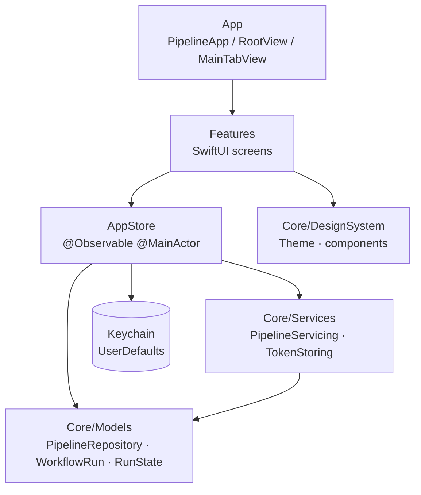

# Architecture

## Goals

- Keep the UI independent of GitHub transport details.
- Make the demo-to-live data swap a dependency change, not a screen rewrite.
- Keep state in one observable place so every screen agrees.
- Make accessibility and previews part of the component design.
- Leave clear seams for caching, widgets, and background refresh.

The current build is a **UI prototype**. `DemoPipelineService` returns sample
data; no network or database layer exists yet.

## Layers



Dependencies point inward. Views may read models and the store, but they do not
call persistence or networking APIs directly.

## Folder structure

```text
pipeline/
├── App/
│   ├── PipelineApp.swift          @main entry point, creates AppStore
│   ├── RootView.swift             Chooses connect or main tabs
│   └── MainTabView.swift          Tab shell with three navigation stacks
├── Features/
│   ├── Connect/                   Token entry and demo mode
│   ├── Dashboard/                 Health summary and watched repositories
│   ├── Repositories/              Searchable watch list
│   ├── RepositoryDetail/          Latest status and recent runs
│   ├── RunDetail/                 Metadata and GitHub link
│   └── Settings/                  Connection, data controls, About
├── Core/
│   ├── Models/                    Domain types
│   ├── Services/                  AppStore and service protocols
│   ├── DesignSystem/
│   │   ├── Theme.swift            Spacing, radius, status colors
│   │   └── Components/            Cards, badges, rows, empty states
│   ├── Extensions/                Navigation, colors, time formatting
│   └── PreviewSupport/            Preview-only fixtures
└── Resources/
    └── Assets.xcassets            Accent color and app icon
```

## State management

`AppStore` is the single source of truth. It is a `@MainActor @Observable` class
created once by `PipelineApp` and injected into the environment:

```swift
@main
struct PipelineApp: App {
    @State private var store = AppStore()

    var body: some Scene {
        WindowGroup {
            RootView()
                .environment(store)
        }
    }
}
```

Screens read it with `@Environment(AppStore.self)`. Mutations go through store
methods, which keeps persistence and validation in one place:

- `connect(token:)`
- `startDemo()`
- `refresh()`
- `disconnect()`
- `deleteAllData()`
- `setWatched(_:repositoryID:)`
- `setPinned(_:repositoryID:)`

### Why one store

- The dashboard summary, tab badges (future), and widget snapshot all need the
  same derived state.
- Preferences and connection state must stay consistent after a refresh.
- Screens do not pass bindings through multiple layers.
- Tests can construct a store with in-memory dependencies.

The tradeoff is that `AppStore` will grow. If it starts owning unrelated
features, split read-only projections (for example a `WidgetSnapshotBuilder`)
rather than adding more view state to it.

### Derived state

| Property | Meaning |
| --- | --- |
| `isConnected` | A token exists or demo mode is on |
| `watchedRepositories` | Watched repositories, pinned first |
| `allRepositories` | Every repository, sorted for the picker |
| `pinnedRepositories` | Watched repositories pinned to the widget |
| `overallState` | Failure > running > queued > unknown > success |
| `healthyCount` / `failingCount` / `activeCount` | Summary counts |

## Data flow

### Launch

1. `PipelineApp` creates `AppStore`.
2. `AppStore.init` loads the token from `KeychainTokenStore` and reads the demo
   flag from `UserDefaults`.
3. `RootView` shows `MainTabView` when connected, otherwise `ConnectView`.
4. `RootView.task` calls `loadInitialDataIfNeeded()`, which fetches repositories
   once if the store is empty.

### Connect

1. `ConnectView` trims the input and calls `store.connect(token:)`.
2. `GitHubTokenValidator` checks the prefix, whitespace, and minimum length.
3. `KeychainTokenStore` saves the token.
4. `AppStore` clears demo mode and reloads repositories.
5. `RootView` observes `isConnected` and swaps to the tabs.

The current validator is **local only**. It cannot confirm that a token is
valid, unexpired, or correctly scoped.

### Refresh

1. `refresh()` guards against concurrent and disconnected refreshes.
2. `reload(showSpinner:)` calls `PipelineServicing.fetchRepositories()`.
3. Stored watch and pin preferences are applied to the fetched models.
4. On success, repositories and `lastRefreshedAt` update.
5. On failure, `errorMessage` is set and the previous data is retained.

Pull-to-refresh and the toolbar refresh button share this path.

### Preferences

Watch and pin changes are written immediately to `UserDefaults` as arrays of
repository IDs. They are reapplied after every fetch, so a server response
cannot silently reset the user's choices.

Pinning requires watching. Un-watching a repository also unpins it.

## Navigation

Each tab owns a `NavigationStack`. `MainTabView` switches between Dashboard,
Repositories, and Settings.

Pushed destinations are centralized in `AppRoute`:

```swift
enum AppRoute: Hashable {
    case repository(id: String)
    case run(repositoryID: String, runID: Int)
    case about
}
```

`appDestinations()` registers the mapping once per stack. Routes carry
identifiers, not model copies, so a detail screen always reads current data from
the store. If a repository disappears after a refresh, the detail screen shows
an empty state instead of stale data.

## Models

### `PipelineRepository`

A repository the app can display, including its recent runs. `recentRuns` sorts
newest first because the API does not guarantee ordering. `latestRun` is the
first item in that sorted list.

### `WorkflowRun`

One workflow execution. GitHub splits lifecycle (`status`) from result
(`conclusion`), so the model keeps both and exposes a UI-friendly `RunState`.

### `RunState`

A single mapping used by every screen:

```text
queued / waiting / requested / pending  -> queued
in_progress                             -> running
completed + success                     -> success
completed + failure/action_required/
            startup_failure             -> failure
completed + cancelled                   -> cancelled
completed + skipped                     -> skipped
completed + neutral                     -> neutral
completed + timed_out                   -> timedOut
completed + stale/nil                   -> unknown
```

Grouping helpers keep summary logic consistent:

- `isFailure`: failure or timed out
- `isActive`: running or queued
- `isHealthy`: success, skipped, or neutral

## Services

### `PipelineServicing`

```swift
protocol PipelineServicing {
    func fetchRepositories() async throws -> [PipelineRepository]
}
```

`DemoPipelineService` sleeps briefly and returns `SampleData.repositories`.
`AppStore` accepts an optional service so tests and previews can inject stubs.

### `TokenStoring`

`KeychainTokenStore` implements the production store. `InMemoryTokenStore` is
used in tests and previews. The Keychain item is a generic password keyed by the
bundle identifier and `github-token`, with
`kSecAttrAccessibleAfterFirstUnlockThisDeviceOnly`.

## Persistence

| Store | Data | Notes |
| --- | --- | --- |
| Keychain | GitHub token | Generic password, this-device-only |
| `UserDefaults` | Demo mode, watched IDs, pinned IDs | Keys prefixed `preferences.` |

There is no database and no cached response body yet. The app always starts from
an empty repository list and fetches on launch.

`deleteAllData()` removes the token and every preference key. `disconnect()`
removes the token and demo flag but leaves watch and pin preferences intact.

## Concurrency

- The project enables `SWIFT_DEFAULT_ACTOR_ISOLATION=MainActor`, so UI and store
  code are main-actor isolated by default.
- Service methods are `async`; `DemoPipelineService` suspends with
  `Task.sleep(for:)`.
- `AppStore` guards against overlapping loads with `isLoading` and
  `isRefreshing`.
- Models are `Sendable` value types.
- Dependencies are `@ObservationIgnored` because replacing them should not
  invalidate views.

## Error handling

| Failure | Presentation |
| --- | --- |
| Invalid token format | Inline error under the connect field |
| Keychain save/read failure | Inline error or store `errorMessage` |
| Repository fetch failure | Dismissible error banner on the dashboard |
| Repository or run missing | Empty state with a recovery hint |
| Empty watch list | Dashboard empty state linking to Repositories |
| No search results | `ContentUnavailableView.search` |

Failed refreshes keep the last successful data and surface an error banner.
There is no automatic retry or backoff yet.

## Preview support

`AppStore.preview` builds a connected store with sample data and an isolated
`UserDefaults` suite. `AppStore.previewDisconnected` builds the connect-screen
variant. Both use `InMemoryTokenStore` and a zero-delay demo service. Preview
fixtures are compiled only in `DEBUG`.

## Extending to the GitHub API

The intended next step:

1. Add `GitHubPipelineService` conforming to `PipelineServicing`.
2. Add DTOs for `/user/repos` and `/repos/{owner}/{repo}/actions/runs`.
3. Map DTOs into `PipelineRepository` and `WorkflowRun`; keep transport types
   out of features.
4. Inject the service in `AppStore.init` when a token is present.
5. Add a network validation step to the connect flow.
6. Handle pagination, rate limits, expired tokens, and offline errors.
7. Test with a stubbed `URLProtocol`; never call GitHub in unit tests.

Views do not need to change. The only required swap is the service dependency.

## Known tradeoffs and technical debt

- Sample data drives every screen; there is no real GitHub client.
- No cache, offline mode, or background refresh yet.
- Token validation is format-only.
- The 96-point tab-bar clearance is repeated in several screens; it should
  become a shared layout token when the tab bar treatment is finalized.
- Localization uses `String(localized:)`, but no string catalog is checked in
  yet.
- The project targets iPhone, iPad, Mac, and Vision, but the layout is designed
  and tested for iPhone only.
- There is no app icon artwork yet; the asset slot is present.
- UI tests cover one demo path; critical error paths are not automated.
